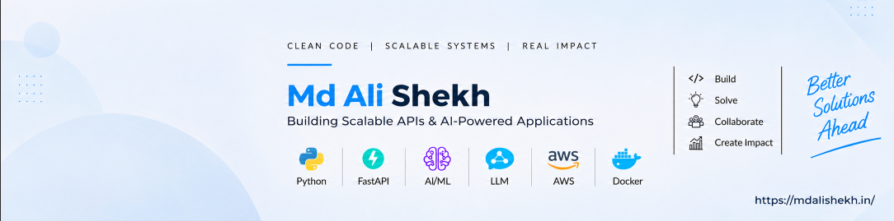

  

<h1> Hi, I'm Ali 👋 </h1>

I'm a Python Backend Developer with 1+ year of professional experience in designing, developing, and maintaining backend applications, REST APIs, and AI-driven applications.

My expertise lies in Python backend development, particularly using FastAPI and Django to build reliable and scalable applications, manage database operations, and integrate third-party services.

Alongside backend development, I have hands-on experience building AI-powered applications, including implementing Retrieval-Augmented Generation (RAG) solutions in professional projects. I've also independently developed Machine Learning projects, further expanding my practical experience in AI/ML technologies.

**What I work with**

- **Languages & Frameworks:** Python, SQL, FastAPI, Django, Django REST Framework
- **Databases & ORM:** PostgreSQL, MySQL, SQLAlchemy, Django ORM
- **Machine Learning:** Scikit-learn, Pandas, NumPy
- **AI & LLM Integration:** OpenAI API, Groq, RAG, LangChain, Vector Database 
- **Cloud & Deployment:** AWS, Docker, Render
- **Tools & Workflow:** Git, GitHub, GitHub Actions, CI/CD

<h2> A bit About Me </h2>

- BCA graduate from Magadh University.
- 1+ year of professional experience in Python Development.
- Primarily focused on Backend Development and API Engineering.
- Interested in Machine Learning, LLM integrations, and AI-powered applications.
- Enjoy learning new concepts, improving problem-solving skills, and building practical solutions.

I'm always open to connecting with developers, discussing technology, sharing ideas, and exploring opportunities to grow as a Python Backend Developer.

If you're working on something interesting with Python or backend technologies, feel free to connect!

<h2> Find Me Around the Web 🌐 </h2>

- **Portfolio:** [https://mdalishekh.in](https://mdalishekh.in)
- **LinkedIn:** [https://linkedin.com/in/mdalishekh](https://in.linkedin.com/in/mdalishekh)
- **Email:** [mdalishekh.work@gmail.com](mailto:mdalishekh.work@gmail.com)
- **GitHub:** [https://github.com/mdalishekh](https://github.com/mdalishekh)
